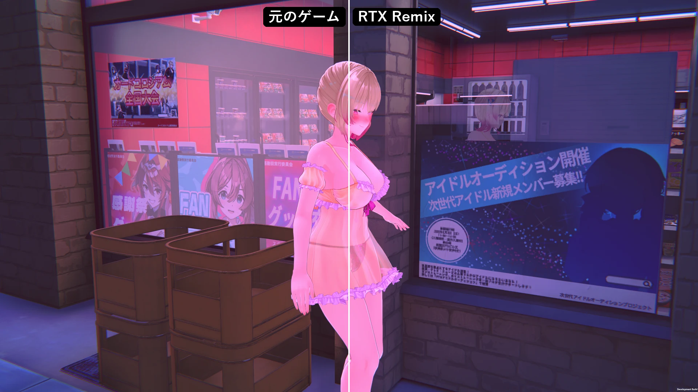
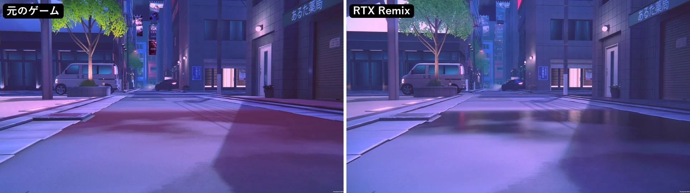
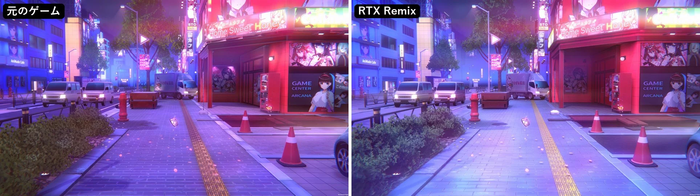
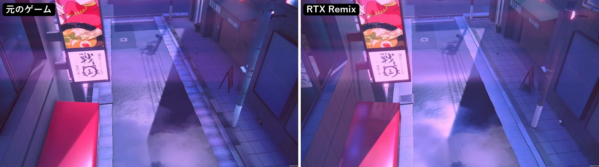
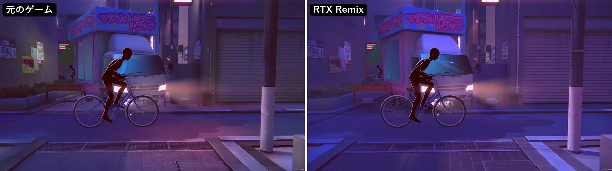
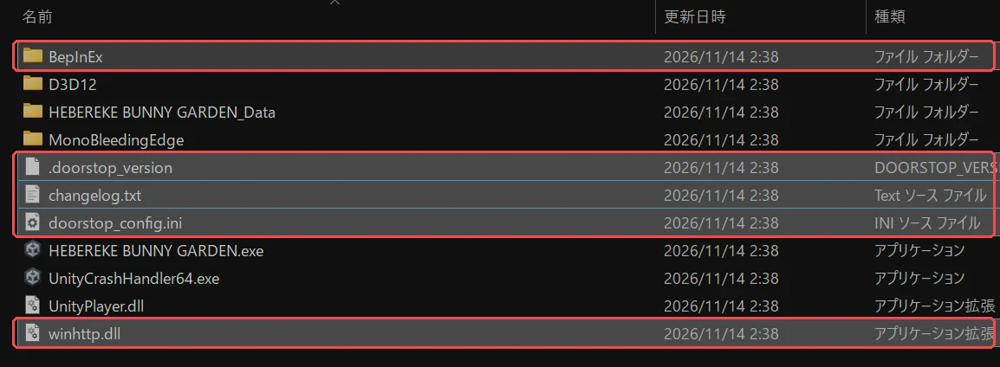
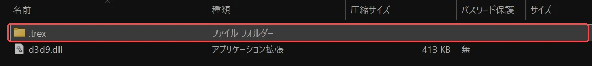
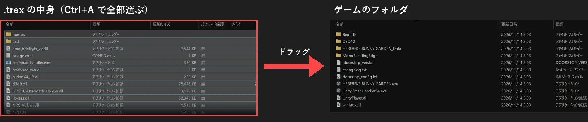
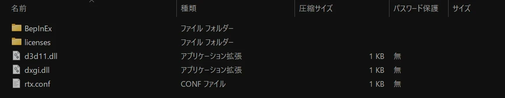
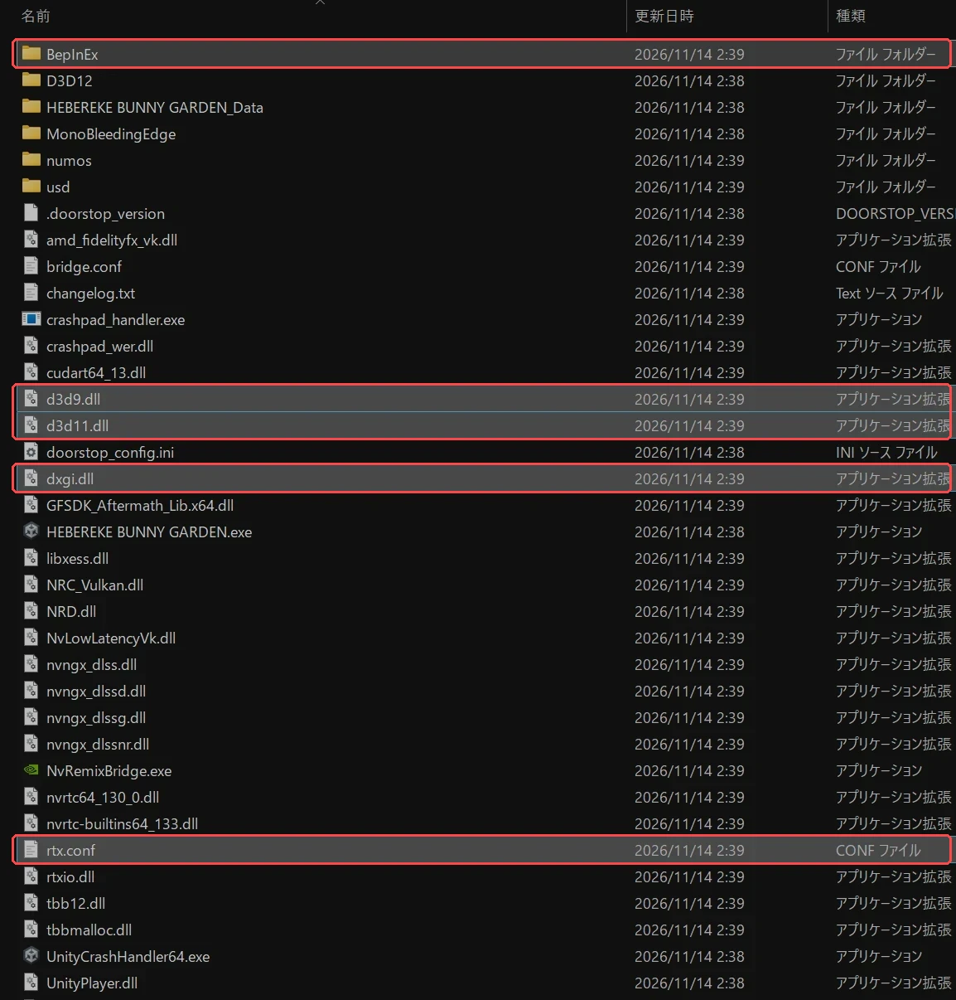

# HeberekeBunnyGardenRemix



[へべれけ ばにーがーでん](https://store.steampowered.com/app/3575730/_/)（海外名: Merry Bunny Garden）の街を、RTX Remix のパストレーシングで描く BepInEx 5 用の Mod です。

街の建物・道路・看板・照明は Remix が光の通り道を計算して描き、キャラクターはその上にゲームがトゥーンの見た目のまま描き重ねます。
濡れた路面やガラスには周りの景色が映り込み、看板や街灯の光が壁や床を照らし、キャラクターは街に影を落とします。

## 見比べ

左が元のゲーム、右がこの Mod です。

### 水たまりの映り込み

濡れた所に、建物や店の入口の明かりがそのまま映ります。



### ネオンの街

看板やネオンの光が、周りの壁や地面を本物の光として照らします。



### 路面の質感

ひび割れたアスファルトのつやは、元のゲームと同じに見えるようにしています。



### 路地のトラック

ヘッドライトの光が路地を照らし、ボディには周りが映り込みます。



## 必要なもの

- Windows 10 / 11（64 ビット）
- **レイトレーシングに対応した GPU**（NVIDIA GeForce RTX を推奨）と最新のドライバー
  - 作者の環境は RTX 5090 です。それより弱い GPU での重さは確かめていません
  - AMD / Intel の GPU でも Remix Plus 自体は動きますが、この Mod では試していません
- Steam 版の へべれけ ばにーがーでん
- [BepInEx 5.4.23](https://github.com/BepInEx/BepInEx/releases)（`BepInEx_win_x64_5.4.23.x.zip`）
- [Remix Plus v2.0.0](https://github.com/RemixProjGroup/dxvk-remix/releases/tag/remix-plus-2.0.0)（`Remix_Plus_v2.0.0.zip`、約 470MB）

## 導入方法

ゲームのフォルダは Steam のライブラリでゲームを右クリック →「管理」→「ローカルファイルを閲覧」で開けます。
以下、このフォルダ（`HEBEREKE BUNNY GARDEN.exe` があるフォルダ）を「ゲームのフォルダ」と呼びます。

### 1. BepInEx 5 を入れる

すでに入っている人（[HeberekeBunnyGardenFixMod](https://github.com/kazumasa200/HeberekeBunnyGardenMod) などを使っている人）は飛ばしてください。

1. `BepInEx_win_x64_5.4.23.x.zip` を開き、**中身を全部**ゲームのフォルダに入れます。赤枠のファイルが増えれば正しく入っています

   

2. ゲームを一度起動して、タイトル画面まで進んだら終了します（`BepInEx` フォルダの中に `plugins` などが作られます）

### 2. Remix Plus を入れる

1. `Remix_Plus_v2.0.0.zip` を開きます
2. zip の中の `game folder` を開くと、`.trex` フォルダと `d3d9.dll` があります。使うのは **`.trex` フォルダの中身**です（`game folder` の `d3d9.dll` は使いません）

   

3. `.trex` フォルダを開き、**中のファイルとフォルダを全部**ゲームのフォルダにコピーします（同じ名前のファイルは上書き）

   

   一部だけコピーすると起動しません。`.trex` の中のフォルダ（`numos` など）も含めて全部コピーしてください。

### 3. この Mod を入れる

1. [Releases](../../releases/latest) から `HeberekeBunnyGardenRemix-1.0.0.zip` をダウンロードします
2. zip の**中身を全部**ゲームのフォルダに入れます（上書きしてよいか聞かれたら「はい」）。`licenses` フォルダはライセンスの文書なので、入れなくてもかまいません

   

入れ終わったゲームのフォルダは、次のようになります（赤枠がこの手順で入れたファイルの一部。下にも Remix Plus のファイルが続きます）。
`d3d11.dll`、`dxgi.dll`、`rtx.conf` はこの Mod、`d3d9.dll` は Remix Plus のファイルです。



### 4. 起動する

**Steam から**起動してください（exe を直接起動すると、ゲームが先に進みません）。

初めての起動では、Remix がシェーダーを準備するので、画面が出るまで少し時間がかかります。ステージに入ると、街が Remix の絵に切り替わります。

## 操作

| キー | 動作 |
|------|------|
| F8 | Remix の絵と、元のゲームの絵を切り替える（見比べ用） |
| Alt+X | Remix のメニューを開く（画質のプリセットや DLSS など） |

動作が重いときは、Alt+X のメニューで画質のプリセットを下げてみてください。

## 外し方

ゲームのフォルダから、次を消します。

- `d3d11.dll` と `dxgi.dll`
- `BepInEx\plugins\HeberekeBunnyGardenRemix` フォルダ

これで元のゲームの描画に戻ります。Remix Plus のファイル（`d3d9.dll` など）は残っていても動作に影響しませんが、消したい場合は `.trex` からコピーしたファイルを消してください。

## 気をつけること

- キャラクターはトゥーンの見た目を保つため、元のゲームと同じ描き方です（影と映り込みだけ Remix が出します）
- ADV パート（会話の場面）の背景は 1 枚の絵なので、見た目はほとんど変わりません
- [HeberekeBunnyGardenFixMod](https://github.com/kazumasa200/HeberekeBunnyGardenMod) と一緒に使えます。ただし、その Mod の解像度の設定がモニターより大きいとき（スーパーサンプリング）は、モニターの解像度で描かれます
- 元のゲームと見た目が違う所があります（Stage09 の広告の柱の絵など）
- 不具合が起きたときは、`BepInEx\LogOutput.log` と `rtx-remix\logs\remix-dxvk.log` を添えて Issue で教えてください

---

## 開発者向け

### ビルド

```bash
dotnet build HeberekeBunnyGardenRemix/HeberekeBunnyGardenRemix.csproj -c Release
```

- ゲームの DLL（`Assembly-CSharp.dll`、`UniTask.dll`、URP など）を `HeberekeBunnyGardenRemix/Assembly/` に置いてください（ゲームの `HEBEREKE BUNNY GARDEN_Data/Managed` から。リポジトリには入れていません）
- `d3d11.dll` / `dxgi.dll` は `native/forwarders/build.cmd`（Visual Studio の C++ が要る）で作ります。Remix Plus の転送用の DLL をそのまま写した物です
- Remix の設定は [docs/rtx.conf](docs/rtx.conf)

### 開発用のスクリプト

`tools/` に、起動・撮影・見比べのスクリプトがあります。使う前に `tools/local.env.example` を `tools/local.env` に写して、ゲームのフォルダを書いてください。

- `tools/restart.sh [Stage01]`: ビルドした DLL を入れて、Steam から起動し直す（ステージ名を付けると、そのステージに直接入る）
- `tools/remixconf.sh 'rtx.なにか = 値'` / `'mod.なにか = 値'`: 動いているゲームに設定を送る
- `tools/shot.sh`: ゲームの中からスクリーンショットを撮る
- F7: 今の場面が何で描かれているかをログに書く。Ctrl+F8: ADV を飛ばして Stage01 に入る

設計と経緯は [docs/design.md](docs/design.md) にあります。

### RTX Remix Toolkit で編集する

メッシュと素材の hash は、起動のたびに同じ値になります（アセットの名前と中身から作る）。Remix のメニューでキャプチャを取り、Toolkit で置き換え（`rtx-remix\mods\<名前>\mod.usda`）を作れば、次の起動でも同じメッシュに当たる見込みです。ただし、実際に Toolkit で置き換えて当たるかはまだ確かめていません。光源は Mod が Remix の API で作っているので、置き換えの対象になりません。

## クレジット

- [Remix Plus](https://github.com/RemixProjGroup/dxvk-remix)（RTX Remix のランタイムの派生版）を使っています。`d3d11.dll` / `dxgi.dll` は Remix Plus のソース（MIT / zlib）をそのままビルドした物で、ライセンスは配布 zip の `licenses` フォルダにあります
- [BepInEx](https://github.com/BepInEx/BepInEx)
